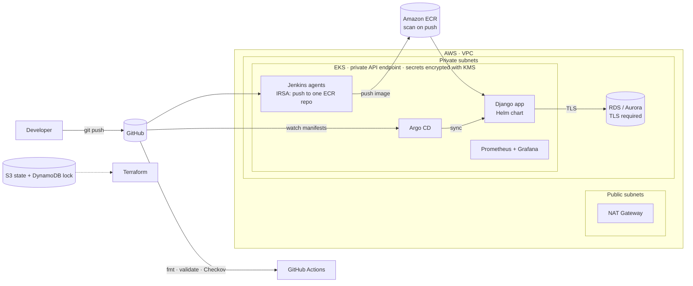

# AWS EKS platform on Terraform

[](https://github.com/tobolovskaya/aws-eks-terraform-platform/actions/workflows/terraform.yml)

> 🇳🇴 **Kort på norsk:** Infrastruktur som kode (Terraform) for en komplett plattform på AWS: nettverk (VPC), Kubernetes (EKS), database (RDS/Aurora), containerregister (ECR), CI/CD med Jenkins, GitOps med Argo CD og overvåking med Prometheus og Grafana. Plattformen er skannet med Checkov og sikret steg for steg i små pull requests: privat API-endepunkt, kryptering med KMS, TLS mot databasen og minste tilgang med IRSA.

Infrastructure as code for a production-style platform on AWS: network, Kubernetes, managed database, container registry, CI/CD, GitOps and monitoring, with a sample Django application on top.

The interesting part is not that it builds, but how it was **hardened**: every change was scanned with Checkov in CI and fixed in a small, reviewed pull request that explains what changed and why.

**Skills shown:** Terraform (modules, remote state, locking) · AWS (VPC, EKS, RDS/Aurora, ECR, IAM, KMS, S3, DynamoDB) · Kubernetes and Helm · CI/CD (GitHub Actions, Jenkins) · GitOps (Argo CD) · DevSecOps (Checkov, gitleaks) · Monitoring (Prometheus, Grafana)

---

## Architecture



## What it builds

| Path | Resources | Why |
|---|---|---|
| `bootstrap/` | S3 bucket, DynamoDB table (one-time) | Remote Terraform state with locking |
| `modules/vpc` | VPC, public and private subnets, NAT Gateway, routes | Workloads and database stay in private subnets |
| `modules/eks` | EKS cluster, managed node group (AL2023), launch template, IAM, OIDC provider, KMS key, EBS CSI add-on | Kubernetes with a private API and least-privilege IAM |
| `modules/rds` | RDS instance **or** Aurora cluster (PostgreSQL / MySQL / MariaDB), parameter groups, security groups | One module for both database types, TLS enforced |
| `modules/ecr` | ECR repository, lifecycle policy, image scanning | Private registry that scans images |
| `modules/jenkins` | Jenkins via Helm, IRSA role for build agents | CI with short-lived, narrowly scoped AWS access |
| `modules/argo_cd` | Argo CD via Helm, ApplicationSet | GitOps: the cluster follows Git |
| `modules/monitoring` | kube-prometheus-stack | Metrics and dashboards |
| `charts/django-app`, `Django/` | Helm chart, app code, Dockerfile, Jenkinsfile | Sample application with `/health/` and `/ready/` probes |

## Security hardening log

Checkov findings went from **33 to 0**: 18 fixed in code, 15 skipped with a written reason next to the resource. The Checkov job in CI is now **blocking**. Each step is its own pull request:

| PR | Change | Why | Checkov |
|---|---|---|---|
| [#8](https://github.com/tobolovskaya/aws-eks-terraform-platform/pull/8) | Make the configuration valid | Module paths, HCL syntax and deprecated arguments blocked `terraform validate` | |
| [#9](https://github.com/tobolovskaya/aws-eks-terraform-platform/pull/9) | GitHub Actions: `fmt`, `validate`, Checkov | Every push is checked before review | |
| [#10](https://github.com/tobolovskaya/aws-eks-terraform-platform/pull/10) | Private EKS API endpoint, KMS for secrets | The Kubernetes API was open to `0.0.0.0/0` | CKV_AWS_38, 39, 58 |
| [#11](https://github.com/tobolovskaya/aws-eks-terraform-platform/pull/11) | TLS required on RDS, `log_statement = ddl`, protected log bucket | No plaintext database traffic, no passwords in query logs, logs cannot be made public or silently deleted | CKV2_AWS_6, CKV_AWS_21 |
| [#12](https://github.com/tobolovskaya/aws-eks-terraform-platform/pull/12) | Kubernetes 1.28 → 1.35, AL2023 nodes, custom `user_data` removed | Unsupported version; the node script piped `curl` into `bash` and added SSH keys | CKV_AWS_339 |
| [#13](https://github.com/tobolovskaya/aws-eks-terraform-platform/pull/13) | IMDS hop limit 1, EBS CSI policy removed from node role | Pods can no longer read instance metadata and steal node credentials | CKV_AWS_341 |
| [#14](https://github.com/tobolovskaya/aws-eks-terraform-platform/pull/14) | IRSA role for Jenkins agents | Build agents can push to one ECR repository, nothing else | |
| [#16](https://github.com/tobolovskaya/aws-eks-terraform-platform/pull/16) | Jenkins builds images with Kaniko, `docker.sock` removed | A mounted Docker socket gives a build root on the node | |
| [#17](https://github.com/tobolovskaya/aws-eks-terraform-platform/pull/17) | Immutable, KMS-encrypted ECR; locked default SG; VPC flow logs; SG descriptions; no DB egress; KMS for state | Tags cannot be overwritten, traffic is logged for incident response, least privilege on the network | CKV_AWS_51, 136, 145, 23, 382, CKV2_AWS_11, 12, 61 |
| #18 | Remaining findings skipped with reasons, CI scan blocking | Accepted risks are documented, not hidden; new findings now fail the build | 15 skips |
| #21 | RDS master password managed by Secrets Manager (`manage_master_user_password`) | The password is generated and rotated by AWS and never appears in variables, plans or Terraform state | |
| #23 | One Django folder; secret key, debug and database settings from environment variables; health and readiness endpoints | The image build referenced a missing folder, the secret key and `DEBUG = True` were hardcoded, and the Kubernetes probes pointed to URLs that did not exist | |
| #24 | GitHub Actions pinned to commit SHAs (kept current by Dependabot), tflint in CI, 55 unused variables removed | A moved tag cannot change what CI runs. Variables such as `enable_csrf_protection` were accepted but did nothing, which gave a false sense of security | |
| #25 | `terraform test` with mocked providers: private EKS API, KMS for secrets, IMDSv2 with hop limit 1, managed DB password, immutable ECR, locked default SG, flow logs | The hardening is now checked on every pull request without an AWS account: if a secure default is changed, CI fails | |

Other defaults:

- Database and worker nodes in **private subnets**
- **Encrypted** Terraform state, with locking in DynamoDB
- **No secrets in Git:** `*.tfvars` and `*.tfstate` are ignored; only `terraform.tfvars.example` with placeholders is committed. Full history scanned with [gitleaks](https://github.com/gitleaks/gitleaks): no leaks found.

## ⚠️ Cost

This project creates **billable AWS resources** that are charged per hour even when idle: the EKS control plane, EC2 worker nodes, the NAT Gateway, RDS and load balancers. It is not covered by the AWS Free Tier. Estimate your own region and sizes with the [AWS Pricing Calculator](https://calculator.aws/).

The CI pipeline runs `terraform validate`, `terraform test` with mocked providers, tflint and Checkov. Nothing is ever created in AWS from this repository.

- To review what would be created, run `terraform plan` only.
- If you run `apply`, clean up with `terraform destroy` afterwards.

## How to run

**Prerequisites:** Terraform ≥ 1.0, AWS CLI with credentials, kubectl, Helm.

```bash
# 1. Remote state (first time only)
cd bootstrap && terraform init && terraform apply && cd ..
#    put the bucket and table names into backend.tf

# 2. Configure
cp terraform.tfvars.example terraform.tfvars   # your own values, never commit this file

# 3. Review
terraform init
terraform plan
```

**Access to the cluster:** the EKS API endpoint is private by default. To use `kubectl` or `helm` from your own machine, allow only your IP:

```hcl
endpoint_public_access       = true
endpoint_public_access_cidrs = ["<your-ip>/32"]
```

```bash
# 4. Deploy, connect and clean up
terraform apply
aws eks update-kubeconfig --region <region> --name <cluster-name>
kubectl get nodes
terraform destroy
```

Run the same checks as CI locally:

```bash
terraform fmt -check -recursive
terraform init -backend=false && terraform validate
checkov -d . --framework terraform --compact --quiet
tflint --init && tflint --recursive
terraform test                        # security tests, mocked providers, no AWS account needed
```

## Project structure

```
├── .github/workflows/terraform.yml   # fmt, validate, test, Checkov, tflint
├── tests/security.tftest.hcl         # security regression tests (mocked AWS)
├── bootstrap/                        # one-time S3 + DynamoDB for remote state
├── main.tf                           # wires all modules together
├── variables.tf                      # root input variables
├── providers.tf                      # AWS, Kubernetes and Helm providers
├── versions.tf                       # Terraform and provider versions
├── backend.tf                        # remote state (eu-north-1, Stockholm)
├── outputs.tf
├── terraform.tfvars.example          # placeholders only
├── modules/
│   ├── vpc/  eks/  rds/  ecr/  jenkins/  argo_cd/  monitoring/  s3-backend/
├── charts/django-app/                # Helm chart for the sample app
└── Django/                           # sample app: code, Dockerfile, Jenkinsfile, local Docker Compose
```

## Roadmap

- [x] `Django/Jenkinsfile`: no more `/var/run/docker.sock`; images are built with Kaniko and pushed to ECR through the IRSA role
- [x] Pin the `kubectl` and `helm` agent images to fixed versions
- [x] Fix or document (`#checkov:skip` with a reason) the remaining Checkov findings, then make the CI scan blocking
- [x] Drop `ecr:BatchDeleteImage` from the optional cross-account ECR policy

## Hva jeg lærte / What I learned

- **A scanner finds misconfigurations, not every risk.** Checkov flagged the open API endpoint, but not that `log_statement = "all"` would write passwords to the database logs. I found that by reading the code.
- **Not every finding is real.** Checkov cannot resolve some `dynamic` blocks and reported TLS as missing when it was set. I learned to skip such checks with a written reason instead of hiding them.
- **Security fixes have dependencies.** IMDS hop limit 1 was only safe after I confirmed the EBS CSI driver used its own IRSA role. The Kubernetes upgrade also meant moving nodes from Amazon Linux 2 to AL2023, because AWS no longer builds AL2 images for 1.33 and later.
- **Check existing code against the official documentation.** The old node script called `bootstrap.sh` itself, which AWS says not to do for managed node groups, and it piped `curl` into `bash` on every node.
- **Small pull requests with a clear "why" are easier to review and to roll back** than one large hardening commit.
- **Use the same tool versions locally and in CI.** My local Checkov and the one in GitHub Actions reported different numbers until I understood why.

---

Built during my MSc in Computer Science (Woolf / GoIT Neoversity, 2026) and hardened afterwards.
**Yevheniia Tobolovska** · IT operations and security · [Portfolio](https://my-portfolio-yevheniia-tobolovskas-projects.vercel.app/) · [LinkedIn](https://www.linkedin.com/in/yevheniia-tobolovska)
